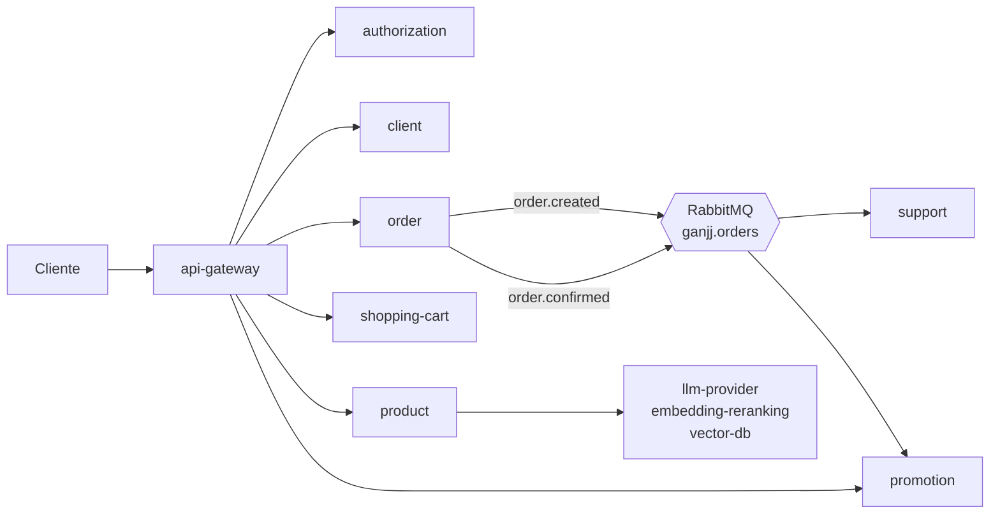

# GANJJ

E-commerce em microsserviços da disciplina Backend: Cloud Computing (PUCPR). Cada serviço tem dono, repo próprio, imagem Docker e manifests Kubernetes.

## Visão geral

O `api-gateway` é a entrada única: valida o JWT (RS256) na borda, aplica rate limit e repassa `X-Correlation-ID`. O `support` não passa pelo gateway: o `order` publica `order.created` no exchange `ganjj.orders` do RabbitMQ e o `support` consome, enviando a notificação. Ao confirmar um pedido, o `order` publica `order.confirmed` e o `promotion` consome para contar o uso do cupom. A publicação sai de uma outbox, para não perder evento se o broker estiver fora.

## Execução

Tudo roda em Kubernetes (EKS, na AWS Academy). O Ingress NGINX expõe só o `api-gateway`; os demais serviços ficam atrás de Services internos e o gateway os encontra pelo DNS do cluster. O gateway e o `promotion` têm Helm chart, e o Prometheus e o Grafana saem do `api-gateway` (`k8s/observability`).

## Serviços

| Repo | Papel | Stack | Dono |
|---|---|---|---|
| [api-gateway](https://github.com/Back-End-Cloud-Computing/api-gateway) | Entrada única, JWT na borda, rate limit, métricas | Node + TypeScript + Fastify | Lucas Stopinski da Silva |
| [authorization](https://github.com/Back-End-Cloud-Computing/authorization) | Credenciais e emissão de JWT | Java + Spring Boot + Oracle | Eduardo Henrique Fabri |
| [client](https://github.com/Back-End-Cloud-Computing/client) | Perfil do cliente | Go + PostgreSQL | Eduardo Henrique Fabri |
| [order](https://github.com/Back-End-Cloud-Computing/order) | Pedidos | .NET + SQL Server | Rodrigo da Silva Alves |
| [shopping-cart](https://github.com/Back-End-Cloud-Computing/shopping-cart) | Carrinho | Node + Express + Redis | João Pedro Cardoso de Liz |
| [product](https://github.com/Back-End-Cloud-Computing/product) | Catálogo e busca | Python + FastAPI + MongoDB | João Vitor Correa Oliveira |
| [promotion](https://github.com/Back-End-Cloud-Computing/promotion) | Promoções, cupons e campanhas | PHP + Laravel + MySQL | Lucas Stopinski da Silva |
| [support](https://github.com/Back-End-Cloud-Computing/support) | Notificações por e-mail, SMS e WhatsApp | Java + Spring Boot + SQLite | Eduardo Henrique Fabri |
| [llm-provider](https://github.com/Back-End-Cloud-Computing/llm-provider) | Abstrai o acesso a um LLM externo (apoio ao `product`) | Python + FastAPI | João Vitor Correa Oliveira |
| [embedding-reranking](https://github.com/Back-End-Cloud-Computing/embedding-reranking) | Embeddings e reranking (apoio ao `product`) | Python + FastAPI | João Vitor Correa Oliveira |
| [vector-db](https://github.com/Back-End-Cloud-Computing/vector-db) | Gerencia o banco vetorial (apoio ao `product`) | Python + FastAPI | João Vitor Correa Oliveira |

## Documentação

A arquitetura completa, as decisões e o alinhamento entre serviços estão em
[`promotion/docs`](https://github.com/Back-End-Cloud-Computing/promotion/tree/main/docs), começando por
[`arquitetura.md`](https://github.com/Back-End-Cloud-Computing/promotion/blob/main/docs/arquitetura.md).
Cada repo traz o próprio `README` e, nos mais novos, uma pasta `docs/`.

## Créditos

Ícones das capas dos repositórios por [Flaticon](https://www.flaticon.com), sob a licença gratuita com atribuição:

| Repo | Ícone | Autor |
|---|---|---|
| api-gateway | [Api](https://www.flaticon.com/free-icon/api_17335208) | nawicon |
| authorization | [Shield](https://www.flaticon.com/free-icon/shield_1962508) | Magnific |
| client | [Profile](https://www.flaticon.com/free-icon/profile_3135768) | Magnific |
| embedding-reranking | [Neural network](https://www.flaticon.com/free-icon/neural-network_13320544) | pojok d |
| llm-provider | [Artificial intelligence](https://www.flaticon.com/free-icon/artificial-intelligence_17632037) | Blackonion02 |
| order | [Checklist](https://www.flaticon.com/free-icon/checklist_2666436) | Magnific |
| product | [Box](https://www.flaticon.com/free-icon/box_679821) | Magnific |
| promotion | [Tag](https://www.flaticon.com/free-icon/tag_14096420) | Fajrul Fitrianto |
| shopping-cart | [Shopping cart](https://www.flaticon.com/free-icon/shopping-cart_9284424) | Magnific |
| support | [Technical Support](https://www.flaticon.com/free-icon/technical-support_4233834) | Magnific |
| vector-db | [Database](https://www.flaticon.com/free-icon/database_9850812) | Magnific |
